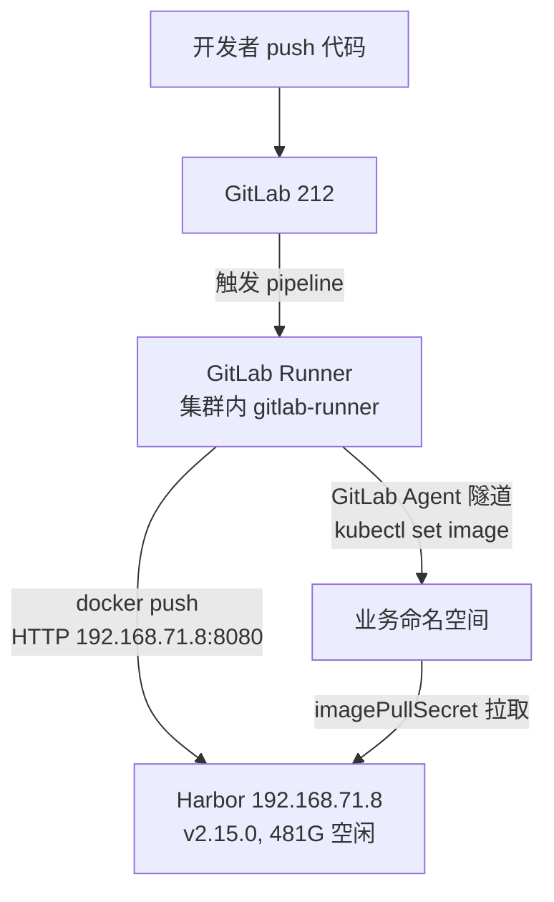

# Harbor 与 GitLab CI/CD 接入集群方案

> 状态：**全部完成**（2026-11-05）。结论：**不新建 Harbor**，直接接入现成的 `192.168.71.8:8080`；构建因 Harbor token 接口限制改用 **Buildah**；部署用 **GitLab Agent**。`git push` → 构建 → 推送 → 滚动更新 全链路已验证（pipeline 122，镜像 `4c7b2e68` 部署成功）。

## 一、目标

1. 复用已有的 Harbor（`192.168.71.8:8080`）作为私有镜像仓库，集群节点能直接拉取；
2. GitLab（`gitlab.liaozesheng.cn`，212 上的 Omnibus 18.9.2）的 CI 能构建镜像并推送到该 Harbor；
3. CI 以最小权限把应用部署进集群，不把长期 kubeconfig 塞进 CI 变量。

## 二、调研结论（2026-11-05）

### 2.1 现有 Harbor

| 项目 | 值 |
|---|---|
| 版本 | Harbor **v2.15.0** |
| 地址 | `http://192.168.71.8:8080`（**仅 HTTP，无 TLS**） |
| external_url | `http://192.168.71.8:8080` |
| 认证 | 数据库认证，`project_creation_restriction=everyone` |
| 存储 | filesystem，**481G / 527G 可用** |
| 现有项目 | `1995chen`、`dockerhub-proxy`、`library`、`myapp`、`ruoyi`、`tmfsi` |
| 代理缓存 | 已配置 `docker-hub`（healthy），可直接代理 Docker Hub |
| 机器人账号 | **无**，需要按项目新建 |

> admin 账号密码不入库，单独保存在密码管理器中。

### 2.2 其他约束

| 项目 | 现状 | 影响 |
|---|---|---|
| 集群 | kubeadm v1.35.10，215 带控制面污点，业务实际跑 214 | 资源按单节点规划 |
| 入口 | 213 终止 TLS，`*.liaozesheng.cn` 转发到 Traefik | 与镜像仓库无关，Harbor 不经过 213 |
| 存储 | SC `nfs`（212:/srv/nfs/k8s） | 本次不新增 Harbor 存储 |
| GitLab | 18.9.2，DigiCert 证书 **2026-11-17 到期** | 需尽快确认自动续期，否则 CI 会 TLS 失败 |
| Runner | 尚无 | 需要新建 |
| 资源 | 212 可用约 3G，214 可用约 5.2G | 构建放集群（214），不挤占 GitLab |
| metrics-server | 未安装 | `kubectl top`/HPA 暂不可用，独立待办 |

## 三、目标架构



| 层 | 组件 | 说明 |
|---|---|---|
| 构建 | GitLab Runner（Kubernetes executor + DinD） | 在 214 上跑 job，构建并推送 |
| 存储 | 现有 Harbor | 私有镜像、扫描、保留策略、机器人账号 |
| 交付 | GitLab Agent for Kubernetes | CI 经隧道部署，无长期凭据 |

Harbor 与 Zot 的分工：Harbor 存**自有镜像**；Zot 继续代理 ghcr/gcr/quay 等公网镜像。Harbor 自带的 `dockerhub-proxy` 项目可代理 Docker Hub，后续可用来替代 daocloud 镜像站。

## 四、阶段一：接入现有 Harbor

### 4.1 节点侧：把 HTTP registry 告诉 containerd

containerd 默认只走 HTTPS，必须为这个地址显式声明 HTTP：

`/etc/containerd/certs.d/192.168.71.8:8080/hosts.toml`

```toml
server = "http://192.168.71.8:8080"

[host."http://192.168.71.8:8080"]
  capabilities = ["pull", "resolve"]
```

```bash
sudo systemctl restart containerd
```

> 目录名必须带端口（`192.168.71.8:8080`），否则 containerd 不认。`config_path` 已在部署 Traefik 时指向 `/etc/containerd/certs.d`。

### 4.2 Harbor 侧：项目与机器人账号

建议新建独立项目，避免和现有业务混用：

| 对象 | 建议 | 权限 |
|---|---|---|
| 项目 | `apps`（私有） | — |
| 机器人 `ci-push` | 项目级 | push + pull |
| 机器人 `cluster-pull` | 项目级 | 仅 pull |

创建方式：Harbor UI → 项目 → 机器人账户，或用 API：

```bash
curl -u admin:<密码> -X POST http://192.168.71.8:8080/api/v2.0/projects/apps/robots \
  -H 'Content-Type: application/json' \
  -d '{"name":"ci-push","duration":-1,"level":"project","permissions":[{"kind":"project","namespace":"apps","access":[{"resource":"repository","action":"push"},{"resource":"repository","action":"pull"}]}]}'
```

> 不要用 admin 跑 CI。机器人 token 只出现一次，拿到后立刻写入 GitLab CI 变量与集群 Secret。

### 4.3 拉取镜像：imagePullSecret

```bash
kubectl -n vehicle-log create secret docker-registry harbor-pull \
  --docker-server=192.168.71.8:8080 \
  --docker-username='robot$cluster-pull' \
  --docker-password='<robot token>'
```

Deployment / Helm values 里挂 `imagePullSecrets: [{name: harbor-pull}]`。

### 4.4 验证结果（2026-11-05）

- [x] 214、215 的 containerd 已配置 HTTP registry 并重启生效
- [x] Harbor 项目 `apps` 创建，`public=false`，匿名拉取返回 401
- [x] 机器人账号创建：`robot$apps+ci-push`（id=1）、`robot$apps+cluster-pull`（id=2）
- [x] `vehicle-log` 命名空间与 `harbor-pull` imagePullSecret 已创建
- [x] 集群拉取私有镜像成功：kubelet 事件 `Successfully pulled image ... in 1.439s`，镜像 10MB
- [x] 推送成功（用 skopeo）：`library/curl:8.12.0` → `apps/smoke:test`，Harbor `repo_count=1`

### 4.5 关键发现：token 接口只接受 GET

两台 Harbor（192.168.71.8 与海外 443）的 `/service/token` 都表现为：

| 方法 | 结果 |
|---|---|
| `GET`（Basic 认证） | 200，能正常换到 token |
| `POST`（`grant_type=password`） | **405 Method Not Allowed** |

这是 Docker 与 containerd 在**提供账号密码**时默认采用的取 token 方式，因此：

- **`ctr images push --user` 会静默失败**：日志里能抓到 405，命令本身却返回 0，Harbor 里什么都不会留下——排查时极容易误判成“推送成功”。
- **`docker login` / `docker push` 大概率同样失败**（同一个客户端流程），DinD 构建方案因此不再可靠。
- **拉取不受影响**：containerd 用 imagePullSecret 时会回退到 GET，kubelet 实测正常。
- **skopeo / buildah 正常**：containers/image 走 GET 流程，推送已验证成功。

如果希望彻底解决，需要在 Harbor 前置的 nginx 上放开 `POST /service/token`（两台机器同一现象，说明是统一的代理配置），这属于对方主机的改动。

## 五、阶段二：GitLab Runner（Buildah 构建）

> 原计划用 DinD，因 4.5 的 token 405 问题调整为 Buildah：它和 skopeo 同属 containers/image 栈，走 GET 取 token，已实测可推送。副作用是**不再需要 privileged**。

### 5.1 安装

```yaml
# gitlab-runner values（要点）
gitlabUrl: https://gitlab.liaozesheng.cn/
runnerToken: <GitLab Runner 页面生成的 authentication token>
runners:
  config: |
    [[runners]]
      [runners.kubernetes]
        namespace = "gitlab-runner"
        privileged = false
        cpu_request = "500m"
        memory_request = "1Gi"
```

### 5.1.1 安装记录（2026-11-05）

| 项 | 值 |
|---|---|
| Chart | `gitlab/gitlab-runner` **0.94.2** |
| Runner 版本 | 19.5.2 |
| Namespace | `gitlab-runner` |
| Runner id | 5（描述 `k8s-runner`，项目级，tag `k8s`） |
| 状态 | GitLab API 显示 `online`，Pod 1/1 Running |
| 特权 | `privileged = true`（Buildah 需要，用户手动开启） |
| 镜像来源 | `registry.gitlab.com/gitlab-org/gitlab-runner:alpine-v19.5.2` |

**附带改动：containerd 走内网代理。** `registry.gitlab.com` 直连拉取 5 分钟都没完成，两台节点新增了 systemd drop-in：

```ini
# /etc/systemd/system/containerd.service.d/proxy.conf
[Service]
Environment="HTTP_PROXY=http://192.168.71.212:7890"
Environment="HTTPS_PROXY=http://192.168.71.212:7890"
Environment="NO_PROXY=localhost,127.0.0.1,192.168.71.0/24,172.245.71.18,10.0.0.0/8,.local,.svc,.cluster.local"
```

之后同一镜像 10 秒拉完。注意 CI job 的 helper 镜像也来自 `registry.gitlab.com`，这一步是必须的。`NO_PROXY` 排除了内网、Harbor 所在的 `192.168.71.0/24`、Zot 所在的 `172.245.71.18` 与 Pod/Service 网段。

### 5.2 最终流水线（已跑通）

```yaml
stages: [build, package]

variables:
  IMAGE: 192.168.71.8:8080/apps/vehicle-log-simulator:$CI_COMMIT_SHORT_SHA
  MAVEN_OPTS: "-Dmaven.repo.local=$CI_PROJECT_DIR/.m2/repository"

build:
  stage: build
  image: 192.168.71.8:8080/dockerhub-proxy/library/maven:3.9-eclipse-temurin-17
  cache:
    key: maven
    paths:
      - .m2/repository
  script:
    - mvn -B -s ci/settings.xml -DskipTests package
  artifacts:
    paths:
      - target/*.jar
    expire_in: 1 week

package:
  stage: package
  image: quay.io/buildah/stable:latest
  variables:
    STORAGE_DRIVER: vfs
  script:
    - buildah bud --isolation chroot --layers --tls-verify=false -t "$IMAGE" -f Containerfile .
    # HARBOR_USER_B64 = base64("robot$apps+ci-push")
    - HARBOR_USER_DECODED=$(printf '%s' "$HARBOR_USER_B64" | base64 -d)
    - buildah login --tls-verify=false -u "$HARBOR_USER_DECODED" -p "$HARBOR_PASSWORD" 192.168.71.8:8080
    - buildah push --tls-verify=false "$IMAGE" "docker://$IMAGE"
  rules:
    - if: $CI_COMMIT_BRANCH == "main"
```

`ci/settings.xml` 把 Maven 指向内网 Nexus：

```xml
<settings>
  <mirrors>
    <mirror>
      <id>nexus</id>
      <url>http://192.168.71.42:8081/repository/maven-public/</url>
      <mirrorOf>*</mirrorOf>
    </mirror>
  </mirrors>
</settings>
```

`Containerfile`：

```dockerfile
FROM 192.168.71.8:8080/dockerhub-proxy/library/eclipse-temurin:17-jre
WORKDIR /app
COPY target/*.jar app.jar
EXPOSE 8080
ENTRYPOINT ["java", "-jar", "/app/app.jar"]
```

### 5.3 两个必须知道的坑

1. **Buildah 需要 privileged**：非特权 Pod 解层时报 `remount /: permission denied`。Runner 的 `[runners.kubernetes] privileged` 必须为 `true`（本环境已由用户开启）。
2. **CI 变量里的 `$` 会被二次展开**：Harbor 机器人用户名是 `robot$apps+ci-push`，直接存进 CI 变量后，脚本里 `$HARBOR_USER` 展开成 `robot+ci-push`（13 字符），登录报 `invalid username/password`。规避方式是把用户名 base64 后存 `HARBOR_USER_B64`，脚本里解码使用。日志里用 `${#VAR}` 打印长度可以快速定位这类问题。

> [!note]
> 如果以后把 Harbor 前置代理的 `POST /service/token` 放开，可以改回 `docker:27-dind` 方案，届时需要在 dind service 上加 `--insecure-registry=192.168.71.8:8080`。

## 六、阶段三：GitLab Agent 部署

### 6.1 Agent 配置

仓库内 `.gitlab/agents/prod/config.yaml`：

```yaml
ci_access:
  projects:
    - id: claude-bot/vehicle-log-simulator
```

```bash
helm repo add gitlab https://charts.gitlab.io
helm upgrade --install prod-agent gitlab/gitlab-agent \
  -n gitlab-agent-prod --create-namespace \
  --set config.token=<agent token> \
  --set config.kasAddress=wss://gitlab.liaozesheng.cn/-/kubernetes-agent/
```

### 6.1.1 安装记录（2026-11-05）

| 项 | 值 |
|---|---|
| Agent id | 3（名称 `prod`） |
| Agent token | 通过 `POST /projects/16/cluster_agents/3/tokens` 单独创建，只显示一次 |
| Helm release | `prod-agent`，ns `gitlab-agent-prod`，2 副本 Running |
| KAS 地址 | `wss://gitlab.liaozesheng.cn/-/kubernetes-agent/`（`/-/kubernetes-agent/` 返回 426 说明路由正常） |
| ServiceAccount | `prod-agent-gitlab-agent` |

### 6.2 权限

Agent 的 CI 隧道使用安装时的 ServiceAccount，直接给它绑定目标命名空间的 `edit` 即可，不需要自建 SA：

```bash
kubectl -n vehicle-log create rolebinding agent-deployer \
  --clusterrole=edit \
  --serviceaccount=gitlab-agent-prod:prod-agent-gitlab-agent
```

> [!note]
> 这等于“所有被 `ci_access` 授权、且走这个 agent 的项目，都能改 `vehicle-log` 命名空间”。目前只授权了 `claude-bot/vehicle-log-simulator` 一个项目；如果以后接入多个项目，建议改用 `ci_access.access_as` + 自建 SA 做更细的隔离。

### 6.3 部署任务

```yaml
deploy:
  stage: deploy
  image: docker.io/alpine/k8s:1.31.0
  environment:
    name: production
  rules:
    - if: $CI_COMMIT_BRANCH == "main"
  script:
    - kubectl config use-context claude-bot/vehicle-log-simulator:prod
    - kubectl apply -f k8s/
    - kubectl -n vehicle-log set image deploy/app app="$IMAGE"
    - kubectl -n vehicle-log rollout status deploy/app --timeout=180s
```

`k8s/deployment.yaml` 里显式带 `imagePullSecrets: [harbor-pull]`，Service 为 ClusterIP 80→8080。

### 6.4 踩坑：kubectl 镜像没有 shell

最初用 `registry.k8s.io/kubectl:v1.35.0`，任务直接失败：

```
failed to create containerd task: exec: "sh": executable file not found in $PATH
```

该镜像是 distroless，连 `/bin/sh` 都没有，而 GitLab Runner 需要用 shell 执行脚本。换成 `docker.io/alpine/k8s:1.31.0`（自带 kubectl、helm、sh）后正常。

## 七、实施顺序

| 步骤 | 内容 | 状态 |
|---|---|---|
| 1 | 215/214 配 HTTP registry 并验证拉取 | ✅ 2026-11-05 |
| 2 | Harbor 建 `apps` 项目 + `ci-push` / `cluster-pull` 机器人 | ✅ 2026-11-05 |
| 3 | `vehicle-log` 命名空间与 imagePullSecret | ✅ 2026-11-05 |
| 4 | 安装并注册 GitLab Runner | ✅ 2026-11-05（chart 0.94.2，online） |
| 5 | 跑通 build → push 冒烟流水线（Buildah） | ✅ 2026-11-05（pipeline 117 全绿） |
| 6 | 安装 GitLab Agent，配 RBAC | ✅ 2026-11-05（agent id 3） |
| 7 | 跑通 build → push → deploy 全链路 | ✅ 2026-11-05（pipeline 122） |
| 8 | 更新笔记与运维文档 | ✅ 2026-11-05 |

## 八、风险与决策记录

| 决策 | 结论 | 理由 |
|---|---|---|
| 是否新建 Harbor | **否**，复用 `192.168.71.8:8080` | 已有 v2.15.0、481G 空闲、带 docker-hub 代理 |
| Harbor 存储位置 | 不涉及 | 沿用现有 filesystem 存储 |
| 构建位置/方式 | 集群内 Runner + **Buildah**（原计划 DinD） | 212 只剩约 3G；且 Harbor token 接口只接受 GET，Docker/ctr 的 POST 流程不可用 |
| 部署方式 | GitLab Agent | 无长期 kubeconfig，GitLab 18.9 原生支持 |
| 仓库选型 | 现有 Harbor | 功能齐全，无需再养一套 |

主要风险：

1. **HTTP 明文**：推送/拉取走内网明文，凭据可被嗅探。短期接受；中期可以把 Harbor 挂到 213 的 `registry.liaozesheng.cn` 做 TLS 终止，但需要调整 Harbor `external_url` 并协调现有使用者。
2. **admin 密码强度不足**：CI 一律用机器人账号；建议后续改强密码并开启项目级配额。
3. **`192.168.71.8` 不在常用网段**：确认该机器长期稳定、有备份；它挂掉时 CI 与拉取同时失败。
4. **客户端兼容性**：Harbor 的 `/service/token` 只支持 GET，`docker push` 与 `ctr push --user` 会失败（后者还静默返回 0）。CI 统一用 Buildah/skopeo；若未来要放开，需要改 Harbor 前置代理。
5. **证书**：GitLab 证书 2026-11-17 到期，需确认续期。
6. **保留策略**：Harbor 项目建议保留最近 20 个 tag，避免长期堆积；481G 虽大但共享给多个项目。

## 九、验收标准

- 开发者 `git push` 到 `main` 后自动：构建镜像 → 推送 `192.168.71.8:8080/apps/...` → 滚动更新集群 Deployment；
- 集群节点拉取私有不依赖任何手工 `docker login`；
- CI 中无长期 kubeconfig、无 admin 凭据；
- 回滚：重跑上一次成功 pipeline 即可回到旧镜像。

## 相关笔记

- [[Harbor_使用_Helm_安装部署]]（旧环境部署经验，本次不新建，仅作参考）
- [[Kubernetes_Traefik_Ingress入口改造]]
- [[Kubernetes_NFS动态存储_部署]]
- [[Zot_镜像代理_集群接入]]
- [[Kubernetes_监控栈_kube-prometheus-stack_部署]]
