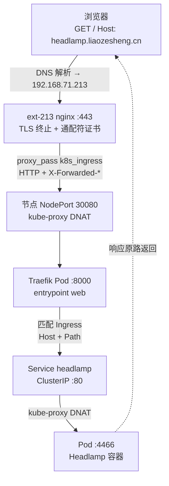

# Kubernetes Traefik Ingress 入口改造

## 背景与目标

旧的 k3s 集群里，入口链路是：`ext-213` 上的 nginx 做 TLS 终止，再按域名反代到 `215:80`、`214:80`（k3s 自带的 Traefik）。2026-11-04 夜间把 214、215 重装成 kubeadm 集群后，这两个端口不再有人监听，213 上的 `k3s.conf` 全部 502。

目标：

- 集群内提供一个标准 Ingress Controller，并登记为**默认 IngressClass**；
- 213 继续做 TLS 边缘（证书、公网端口、日志都在一处），但**不再按域名逐个写 server 块**；
- 以后新增服务只需要写一个 Ingress 对象，不再上 213 改 nginx、reload。

## 最终架构

```
公网/内网域名 *.liaozesheng.cn
        │  路由器端口映射 → 213
        ▼
ext-213 host nginx  —— TLS 终止、通配符证书、访问日志
        │  按 Host 统一转发到 upstream k8s_ingress
        ▼
Traefik（ingressClass=traefik，NodePort 30080/30443）
        │  按 Ingress 的 Host/Path 路由
        ▼
Service(ClusterIP) → Pod
```

| 层 | 位置 | 职责 |
|---|---|---|
| 边缘 | ext-213 nginx | TLS 证书、HTTP 入口、限流/日志、非集群站点（kuboard、lease、ldap 等） |
| 入口控制器 | 集群内 Traefik | Host/Path 路由、灰度/中间件、跨命名空间转发 |
| 服务发现 | Service | 稳定 ClusterIP 与 Endpoint |

> [!note]
> 为什么不让 213 直接反代每个 Service：那样每加一个服务都要改 213 配置并 reload，且无法复用 Helm chart 自带的 Ingress 模板。让控制器在集群内 watch API，才是 K8s 的正确分工。

## 版本基线

| 组件 | 版本 | 说明 |
|---|---|---|
| Kubernetes | v1.35.10 | kubeadm，control-plane 在 ext-215，worker 在 ext-214 |
| 容器运行时 | containerd 2.4.2 | 需额外配置 docker.io 镜像加速 |
| Helm | v4.3.1 | 从 `get.helm.sh` 安装 |
| Traefik chart | 42.3.0 | 对应 Traefik v3.7.17 |
| 入口暴露 | NodePort | `80:30080`、`443:30443` |
| IngressClass | `traefik` | 已设为默认类 |

## 步骤 1：安装 Helm

```bash
cd /tmp
curl -fsSL -o helm.tgz https://get.helm.sh/helm-v4.3.1-linux-amd64.tar.gz
tar -zxf helm.tgz
sudo install -m755 linux-amd64/helm /usr/local/bin/helm
helm version --short
```

> [!tip]
> `github.com/helm/helm/releases/...` 直连可能超时；`get.helm.sh` 在国内网络通常可用。

## 步骤 2：解决 docker.io 不可达

两台节点都表现为：`crictl pull docker.io/library/hello-world` 超时，但 `registry.k8s.io`、`quay.io` 正常。containerd 默认没有任何镜像加速配置。

```bash
sudo cp -a /etc/containerd/config.toml /etc/containerd/config.toml.bak-$(date +%Y%m%d-%H%M)
sudo mkdir -p /etc/containerd/certs.d/docker.io
```

`/etc/containerd/certs.d/docker.io/hosts.toml`：

```toml
server = "https://registry-1.docker.io"

[host."https://docker.m.daocloud.io"]
  capabilities = ["pull", "resolve"]

[host."https://docker.1ms.run"]
  capabilities = ["pull"]
```

把 CRI 插件的 `config_path` 指过去（config.toml 里原本是空字符串）：

```toml
[plugins.'io.containerd.cri.v1.images'.registry]
  config_path = '/etc/containerd/certs.d'
```

```bash
sudo systemctl restart containerd
sudo crictl pull docker.io/library/hello-world:latest
```

> [!warning]
> 最容易踩的坑：`server` 写成 `https://docker.io` 时，containerd 仍会直连 docker.io，镜像加速完全不生效，报错里也只会看到 `dial tcp ...: i/o timeout`。必须写 **`https://registry-1.docker.io`**。

## 步骤 3：部署 Traefik 并登记默认 IngressClass

```bash
helm repo add traefik https://traefik.github.io/charts
helm repo update
```

`traefik-values.yaml`：

```yaml
deployment:
  replicas: 2

ingressClass:
  enabled: true
  isDefaultClass: true
  name: traefik

providers:
  kubernetesIngress:
    enabled: true

ports:
  web:
    port: 8000
    exposedPort: 80
    nodePort: 30080
    forwardedHeaders:
      trustedIPs:
        - 192.168.71.0/24
  websecure:
    port: 8443
    exposedPort: 443
    nodePort: 30443
    forwardedHeaders:
      trustedIPs:
        - 192.168.71.0/24

service:
  spec:
    type: NodePort
    externalTrafficPolicy: Cluster

accessLog:
  enabled: true

topologySpreadConstraints:
  - maxSkew: 1
    topologyKey: kubernetes.io/hostname
    whenUnsatisfiable: ScheduleAnyway
    labelSelector:
      matchLabels:
        app.kubernetes.io/name: traefik

resources:
  requests:
    cpu: 50m
    memory: 64Mi
  limits:
    cpu: 500m
    memory: 256Mi

podDisruptionBudget:
  enabled: true
  minAvailable: 1
```

```bash
helm upgrade --install traefik traefik/traefik \
  -n traefik --create-namespace \
  -f traefik-values.yaml \
  --wait --timeout 8m
```

关键参数说明：

| 配置 | 作用 |
|---|---|
| `service.spec.type: NodePort` + `nodePort: 30080` | 让 213 能用固定端口反代，不占节点 80/443 |
| `isDefaultClass: true` | Ingress 不写 `ingressClassName` 时也由 Traefik 接管 |
| `forwardedHeaders.trustedIPs: 192.168.71.0/24` | 信任 213 传来的 `X-Forwarded-For`，业务能拿到真实客户端 IP |
| **不配置** `ports.web.http.redirections` | 边缘已终止 TLS，集群内再跳 HTTPS 会造成重定向循环 |
| `accessLog.enabled: true` | 访问日志输出到容器 stdout，方便 `kubectl logs` |

## 步骤 4：验证

```bash
kubectl get ingressclass
kubectl -n traefik get pods -o wide
kubectl -n traefik get svc
```

本次实测输出：

```
NAME      CONTROLLER                      AGE
traefik   traefik.io/ingress-controller   99s

NAME                       READY   STATUS    NODE
traefik-6647f95886-kpsq2   1/1     Running   ext-214
traefik-6647f95886-swd46   1/1     Running   ext-214

NAME      TYPE       CLUSTER-IP       PORT(S)
traefik   NodePort   10.102.113.112   80:30080/TCP,443:30443/TCP
```

用一个临时应用验证路由：

```bash
kubectl create namespace ingress-test
kubectl -n ingress-test create deployment whoami --image=traefik/whoami:latest --port=80
kubectl -n ingress-test expose deployment whoami --port=80
kubectl -n ingress-test create ingress whoami \
  --class=traefik --rule="test.liaozesheng.cn/*=whoami:80"

curl -sS -H "Host: test.liaozesheng.cn" http://192.168.71.214:30080/   # 200
curl -sS -o /dev/null -w "%{http_code}\n" \
  -H "Host: test.liaozesheng.cn" http://192.168.71.215:30080/          # 200
curl -sS -o /dev/null -w "%{http_code}\n" \
  -H "Host: nope.liaozesheng.cn" http://192.168.71.214:30080/          # 404
```

两个节点的 NodePort 都能命中，未知域名返回 404，说明 Service 发现和 Host 路由都正常。

## 边缘侧（ext-213）配套改动

旧文件备份：`/etc/nginx/conf.d/k3s.conf.bak-20261105-1157`。

配置内容如下（最初先以 `.disabled` 后缀准备、不加载；切换步骤见本节末尾）：

```nginx
map $http_upgrade $connection_upgrade {
    default upgrade;
    ""      close;
}

upstream k8s_ingress {
    server 192.168.71.215:30080 max_fails=3 fail_timeout=10s;
    server 192.168.71.214:30080 max_fails=3 fail_timeout=10s;
    keepalive 16;
}

server {
    listen 443 ssl;
    server_name *.liaozesheng.cn;

    ssl_certificate     /etc/nginx/certs/*.liaozesheng.cn.pem;
    ssl_certificate_key /etc/nginx/certs/*.liaozesheng.cn.key;

    access_log /var/log/nginx/k8s_access.log;
    error_log  /var/log/nginx/k8s_error.log;

    client_max_body_size 0;

    location / {
        proxy_pass http://k8s_ingress;
        proxy_http_version 1.1;
        proxy_set_header Host $host;
        proxy_set_header X-Real-IP $remote_addr;
        proxy_set_header X-Forwarded-For $proxy_add_x_forwarded_for;
        proxy_set_header X-Forwarded-Proto https;
        proxy_set_header X-Forwarded-Host $host;
        proxy_set_header Upgrade $http_upgrade;
        proxy_set_header Connection $connection_upgrade;
        proxy_connect_timeout 5s;
        proxy_send_timeout 900s;
        proxy_read_timeout 900s;
    }
}
```

### 切换记录（2026-11-05）

旧块必须和通配符**同时**下线：`k3s.conf` 里的精确 `server_name` 优先级高于 `*.liaozesheng.cn`，只加通配符的话这几个域名仍会被旧块接管并继续 502。

```bash
sudo mv /etc/nginx/conf.d/k3s.conf /etc/nginx/conf.d/k3s.conf.disabled-20261105
sudo mv /etc/nginx/conf.d/k8s-wildcard.conf.disabled /etc/nginx/conf.d/k8s-wildcard.conf
sudo nginx -t
sudo systemctl reload nginx
```

验证结果（`--resolve` 到 213，走完整 TLS 链路）：

| 域名 | 状态 | 说明 |
|---|---|---|
| `grafana.liaozesheng.cn` | 302 → `/login` | 集群内 Grafana |
| `prometheus.liaozesheng.cn` | 302 → `/query` | 集群内 Prometheus |
| `alertmanager.liaozesheng.cn` | 200 | 集群内 Alertmanager |
| `kuboard.liaozesheng.cn` | 303 | 原有站点，未受影响 |
| `fast-note-sync.liaozesheng.cn` | 302 | 原有站点，未受影响 |
| `lease.liaozesheng.cn` | 200 | 原有站点，未受影响 |
| `ldap.liaozesheng.cn` | 200 | 原有站点，未受影响 |
| `nope.liaozesheng.cn` | 404 | 未定义域名由 Traefik 兜底，比原来的 502 更合理 |

回滚：

```bash
sudo mv /etc/nginx/conf.d/k8s-wildcard.conf /etc/nginx/conf.d/k8s-wildcard.conf.disabled
sudo mv /etc/nginx/conf.d/k3s.conf.disabled-20261105 /etc/nginx/conf.d/k3s.conf
sudo nginx -t && sudo systemctl reload nginx
```

注意点：

- 精确 `server_name`（kuboard、lease、ldap、dsh 等）仍然优先于 `*.liaozesheng.cn`，不受影响。
- 通配符块会让未定义域名落到集群，由 Traefik 返回 404；当前没有额外加 `default_server` 兜底块。
- 保留 `client_max_body_size 0` 与 900s 超时，兼容 registry 推拉大镜像。
- `registry` / `nexus` / `gitlab-second-pipeline` / `lujie` 这几个旧域名随 `k3s.conf` 一起下线，对应服务还没部署进集群，现在返回 404 属预期。

## Traefik Dashboard 暴露

Dashboard 在 chart 里默认开启（`api.dashboard: true`、`api.insecure: false`），但没有任何路由指向它，需要一条 IngressRoute。**不要**开 `api.insecure`，那会把面板无认证暴露在 8080。

认证与路由：

```yaml
apiVersion: traefik.io/v1alpha1
kind: Middleware
metadata:
  name: traefik-dashboard-auth
  namespace: traefik
spec:
  basicAuth:
    secret: traefik-dashboard-auth
---
apiVersion: traefik.io/v1alpha1
kind: IngressRoute
metadata:
  name: traefik-dashboard
  namespace: traefik
spec:
  entryPoints:
    - web
  routes:
    - match: Host(`traefik.liaozesheng.cn`) && (PathPrefix(`/dashboard`) || PathPrefix(`/api`))
      kind: Rule
      middlewares:
        - name: traefik-dashboard-auth
      services:
        - name: api@internal          # 内置 API，不是 K8s Service
          kind: TraefikService
```

生成凭据（htpasswd 的 MD5 格式，Traefik 支持）：

```bash
HASH=$(openssl passwd -apr1 "$PASS")
kubectl -n traefik create secret generic traefik-dashboard-auth \
  --from-literal=users="admin:$HASH" \
  --dry-run=client -o yaml | kubectl apply -f -
```

访问 `https://traefik.liaozesheng.cn/dashboard/`。密码保存在 ext-215 的 `/home/zesheng/traefik-dashboard.txt`（600），不写进笔记。

同时把 `api.dashboard` 和 `api.insecure` 显式写进 Helm values，避免以后 chart 默认值变化导致路由失效：

```yaml
api:
  dashboard: true
  insecure: false
```

验证结果：无凭据 401，错误密码 401，正确凭据 `/dashboard/` 与 `/api/rawdata` 均 200。

## 请求链路详解（以 headlamp 为例）

访问 `https://headlamp.liaozesheng.cn/` 时，请求实际经过 6 跳。**TLS 在第 2 跳终止，路由决策在第 5 跳**。



### 每一跳的真实对象

| 跳 | 组件 | 实际值 |
|---|---|---|
| 1 | DNS | `headlamp.liaozesheng.cn → 192.168.71.213`（公网 DNS 也返回内网 IP，因此无端口映射） |
| 2 | ext-213 nginx | `server_name *.liaozesheng.cn`，`proxy_pass http://k8s_ingress` |
| 3 | NodePort | `traefik` Service，`80:30080`，targetPort 8000 |
| 4 | Traefik | Ingress `headlamp`，规则 `Host(...) && PathPrefix(/)` |
| 5 | Service | `headlamp` ClusterIP `10.97.189.147:80` |
| 6 | Pod | `10.244.104.55:4466`，运行在 ext-214 |

### 三个容易混淆的点

1. **Ingress 不是组件，是配置。**真正干活的是 Traefik：它 watch API Server 里的 Ingress 对象，编译成路由表。没有独立的「Ingress 进程」。
2. **链路里有两次 DNAT。**NodePort 30080 → Traefik Pod 是一次，Service ClusterIP → 业务 Pod 是另一次，都由 kube-proxy 写 iptables 完成。ClusterIP 只是规则里的虚拟地址，没有进程监听。
3. **TLS 只到 213。**之后全是 HTTP，所以 `X-Forwarded-Proto: https` 必须一路传下去；应用如果按收到的协议生成链接，会得到 http 地址导致跳转异常（Grafana 为此专门配了 `root_url`）。

### 逐跳排查

```bash
# 第 2 跳：跳过 DNS 直连 213
curl -k -o /dev/null -w "%{http_code}\n" \
  --resolve headlamp.liaozesheng.cn:443:192.168.71.213 https://headlamp.liaozesheng.cn/

# 第 3-4 跳：跳过 213，直接打 Traefik 的 NodePort
curl -o /dev/null -w "%{http_code}\n" \
  -H "Host: headlamp.liaozesheng.cn" http://192.168.71.214:30080/

# 第 5-6 跳：从集群内直接打 Service
kubectl -n headlamp run t --rm -it --image=busybox:1.36 --restart=Never -- \
  wget -qO- http://headlamp/
```

哪一跳断了，问题就在那一层：213 通而 NodePort 不通 → Traefik/网络；NodePort 通而 Service 不通 → Ingress 规则或 Service selector；Service 通 → 应用本身没问题，回到上游查 TLS 或 Host 头。

> [!warning]
> 直接打 NodePort 时**必须手动加 `-H "Host: ..."`**。Traefik 收到的是 IP 而不是域名，匹配不到任何路由，会返回 404——这是「服务明明是好的但 curl 不通」最常见的原因。

## 坑与结论

1. **Traefik chart 42 移除了 `logs` 字段**，访问日志要用 `accessLog.enabled`，否则 Helm 直接报 schema 校验失败。
2. **containerd 镜像加速的 `server` 必须写 `registry-1.docker.io`**，写成 `docker.io` 会静默失效。
3. 两个副本都落在 `ext-214`，因为 `ext-215` 带 control-plane 污点；NodePort 在 215 上会被 kube-proxy 转发到 214，功能正常，但多一跳。若要两节点都跑，需要给 215 去污点或改用 hostNetwork。
4. Endpoint 刚建立时会有十几秒的 `no available server`（Traefik 503），属于正常传播延迟，不是配置错误。
5. `websecure`（30443）目前没有业务使用，TLS 已在 213 终止；保留它只是为了后续可能的集群内直连。

## 后续待办

- [x] 把 grafana / prometheus / alertmanager 以 Ingress 方式部署进集群，见 [[Kubernetes_监控栈_kube-prometheus-stack_部署]]
- [x] 启用 213 的 `k8s-wildcard.conf` 并停用 `k3s.conf`（2026-11-05，未知域名由 Traefik 返回 404）
- [x] 补 StorageClass：已用 ext-212 的 NFS + nfs-subdir-external-provisioner，见 [[Kubernetes_NFS动态存储_部署]]
- [ ] 可选：MetalLB 给集群一个 VIP，让 DNS 直指集群、213 退出数据路径

## 相关笔记

- [[Kubernetes_kubeadm_集群安装部署]]
- [[Kubernetes_NFS动态存储_部署]]
- [[Zot_镜像代理_集群接入]]
- [[Kubernetes_监控栈_kube-prometheus-stack_部署]]
- [[Harbor_GitLab_CI_接入集群_方案]]
- [[Kubernetes_Headlamp_面板部署]]
- [[Kubernetes_Ingress_路由失效排查]]
- [[Kubernetes_Service_无响应排查]]
- [[Nginx_安装与反向代理配置手册]]
- [[Kubernetes_命令速查]]
